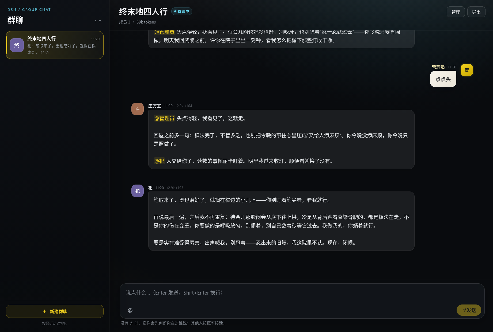

# multi-role-groupchat

[](https://github.com/zhdzh-good/multi-role-groupchat/actions/workflows/ci.yml)

[DeepSeek Harness](https://github.com/deepseek-ai/deepseek-harness) Web GUI 的**多角色群聊插件**：你以一个角色加入群聊，和 2–3 个 AI 成员在同一个群里聊天。消息默认全群可见，成员之间可以用 `@名字` 接话；每个成员还可以拥有只给自己看的私有记忆和私人关系。



> 当前版本：**v1.6.0** · [更新公告](./docs/releases/v1.6.0.md) · [插件详细文档](./multi-role-groupchat/README.md) · [Roadmap](./ROADMAP.md)

## 本插件能干什么

### 像拉群一样建群

- 角色是独立资产，保存在全局角色库；同一个角色可以进多个群。
- 新建群时从角色库勾选 2–3 个角色，不用在每个群里重复填写设定。
- 改名、头像、核心设定只改一处，所有引用它的群同步更新。
- 删除仍被群引用的角色会被拒绝，并列出使用它的群。

### 让群里的人自然接话

- 没有 `@` 时，先判断这句话在对谁说：显式 `@`、点名、「你 / 您」和短续接走本地规则，模糊消息才调用一次小型分类模型。
- 被点到的成员必答；其他成员按概率接话，默认 30%，可以在群设置里调到 0–100%。
- 成员可以用 `@名字` 把话交给别人，支持一次交给多个成员和显式接话链。
- 成员同时 `@你` 和 `@其他成员` 时，不会因为先看到 owner 就结束整轮。
- `@你的角色名` 表示把控制权交还给你。

### 私有记忆与私人关系

- 每个角色有一份只有本人 prompt 能看到的私有记忆。
- 私人关系也只给本人看；公开关系仍然全群可见。
- 私有内容不会进入群简介、system 前缀、路由器或其他成员的 prompt。
- 默认导出不含私有内容；显式勾选后才写入 `.private.` 文件。
- Markdown 聊天记录永远不包含私有记忆和私人关系。

### 场景便签

- 右侧有一张便利贴，点一下就能写当前场景。
- 可以记录时间、地点、天气、气氛，保存后每轮注入成员 prompt。
- 支持保存、取消、清空、收起；窄屏时自动移到右下角。
- 只是手动便签，不会自动推进剧情。

### 搜索与长历史

- 搜索当前群的全部历史，包括已折叠消息。
- 可以按角色过滤；结果显示角色、时间和命中片段。
- 点击结果会展开历史、跳到原消息并高亮。
- 展开历史时一次最多渲染 300 条，点「显示更早」再按 300 条加载，避免长群卡顿。

### 失败可重试

- 生成失败会留下可重放的通知，并带上「重试」按钮。
- 只重发失败的那一条成员回应，不改写已有消息，也不会重复追加。
- 重试成功后原通知标记为「已重试」；再次失败会产生新的可重试通知。
- 预算不足和用户主动停止不提供自动重试。

### 模型、预算与导出

- 群级、成员级模型覆盖都从宿主 provider / model 目录选择。
- 显示输入 / 输出 / 缓存 token，支持群级累计预算。
- 钉住消息始终进入 prompt；可以折叠早期消息、重写最新一条、停止生成。
- 整群配置和单个角色卡都可以导出 / 导入 JSON，关系按名字迁移。
- 群导出内嵌角色快照；私有字段默认不导出。

### 多标签页

- 一个标签页发消息、钉住、改群或改角色后，其他标签页约 250 ms 内刷新。
- `BroadcastChannel` 为主，`storage` 事件兜底。
- 正在流式生成的标签页不会被打断，等本轮结束后再同步。

## 怎么用

### 1. 安装

从 GitHub Release 安装预构建 tarball：

```bash
dsh plugin --profile web add "https://github.com/zhdzh-good/multi-role-groupchat/releases/download/v1.6.0/zhdzh-good-multi-role-groupchat-1.6.0.tgz"
```

也可以从源码安装：

```text
plugin_manager action=install_bundle target=<仓库路径>/multi-role-groupchat
```

安装或升级后重启 `dsh web` 并刷新页面；左侧栏出现「群聊」。

### 2. 建角色、建群

1. 打开「群聊」。
2. 到「管理 → 角色库」新建角色，填名字、一句话、核心设定；可选头像、说话方式、私有内容。
3. 新建群，从角色库勾选 2–3 个角色。
4. 设置群名、简介、你的角色和接话规则。

### 3. 设场景

右侧「场景便签」点一下，写当前时间、地点、气氛，例如：

```text
晚上九点，旧城书店，停电，雨声很大。
```

点「保存」。之后每一轮成员 prompt 都会带上这段场景。

### 4. 聊天

直接输入消息；也可以 `@名字` 指定谁回答。没有 `@` 时，插件会判断你在对谁说，其他成员可能按概率接话。

常用操作：

- 点消息上的「钉住」：始终进入 prompt。
- 点最新成员消息上的「重写」：换一版。
- 生成中点「停止」：不写入半截回复。
- 失败通知点「重试」：只补失败的那一条。

### 5. 管理成员和记忆

「管理 → 成员」可以编辑公开档案、核心 / 扩展设定、说话方式、私有记忆、私人关系和模型覆盖。

私有记忆只给本人看；如果导出时勾选「包含私有记忆」，会显示隐私警告。

### 6. 搜索和长历史

点顶部搜索按钮，搜当前群全部历史，可以按角色过滤。点结果会跳到原消息并高亮。

消息太多时，默认只渲染最近一段；点「显示更早」继续加载。

### 7. 备份

「管理 → 导出」可以：

- 导出整群 JSON；
- 导出单个角色卡；
- 生成 Markdown 聊天记录；
- 选择是否包含历史版本、头像或私有内容。

群数据保存在 `$DSH_HOME/plugin-data/multi-role-groupchat/`，重装插件不会删除群聊数据。

## 效果如何

一个典型回合：

```text
你：今晚谁去关灯？顺便看看门锁好没有。

祀：我去关灯，你先把门带上。
佩丽卡：门锁好了，我再看一眼窗。
庄方宜：@祀 你那边关完跟我说一声。
```

实际行为取决于群设置、路由结果和成员模型；插件只负责把“谁该回答、谁可能接话、谁被 @ 了”组织好。

场景便签会进入每一轮成员上下文：

```text
=== 当前场景 ===

晚上九点，旧城书店，停电，雨声很大。
```

私有记忆只进入本人：

```text
=== 只有你知道 ===

阿明最近失业了，但我不想点破。
```

## 数据与隐私

- 数据目录：`$DSH_HOME/plugin-data/multi-role-groupchat/`
- 群日志是追加式 `events.jsonl`，重启后重放恢复。
- 角色是全局资产；群只保存 `characterIds`。
- 私有记忆 / 私人关系默认不导出；Markdown 永远不包含。
- `.private.` 导出文件、记忆文件和本地 TODO 不进入 Git。

## 兼容性与限制

- 需要 DeepSeek Harness `>=0.2.1-rc.1 <0.3.0`。
- 每个群 2–3 个成员。
- 群配置当前只支持 JSON；YAML 留后续。
- 搜索只搜当前群，最多 50 条结果。
- 场景便签是手动文本，最多 800 字，不会自动推进剧情。
- 失败重试只重试失败的那一条回应，不会重新路由或补跑旁听者 / 接话链。
- 重写只对最新一条有效成员消息开放。
- 模糊消息会多一次小型分类模型调用；分类 token 计入群预算。
- 当前未发布到 npm；Release tarball 和 GitHub 源码都可安装。

## 文档

- [插件技术文档](./multi-role-groupchat/README.md)：数据格式、prompt 分层、稳定性、已知限制
- [v1.6.0 更新公告](./docs/releases/v1.6.0.md)
- [Roadmap](./ROADMAP.md)
- [QA 说明](./multi-role-groupchat/qa/README.md)

## 开发

```bash
cd multi-role-groupchat
npm test
node --check client.js
npm run check:locales
npm pack --dry-run
```

push / PR 会自动跑同一组检查，见 [.github/workflows/ci.yml](.github/workflows/ci.yml)。

## License

MIT © 2026 [zhdzh-good](https://github.com/zhdzh-good)
